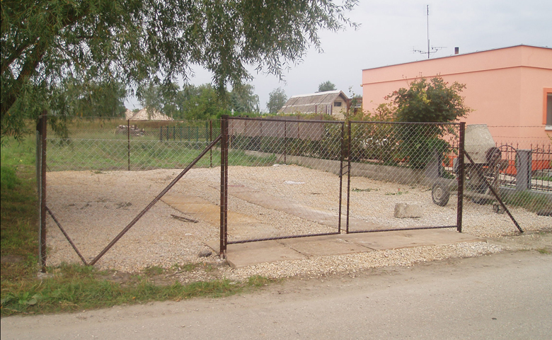
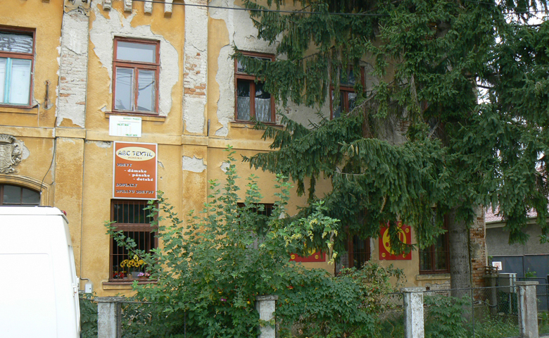
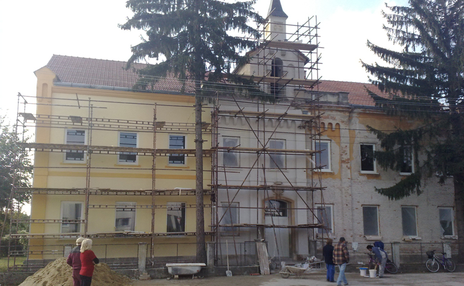
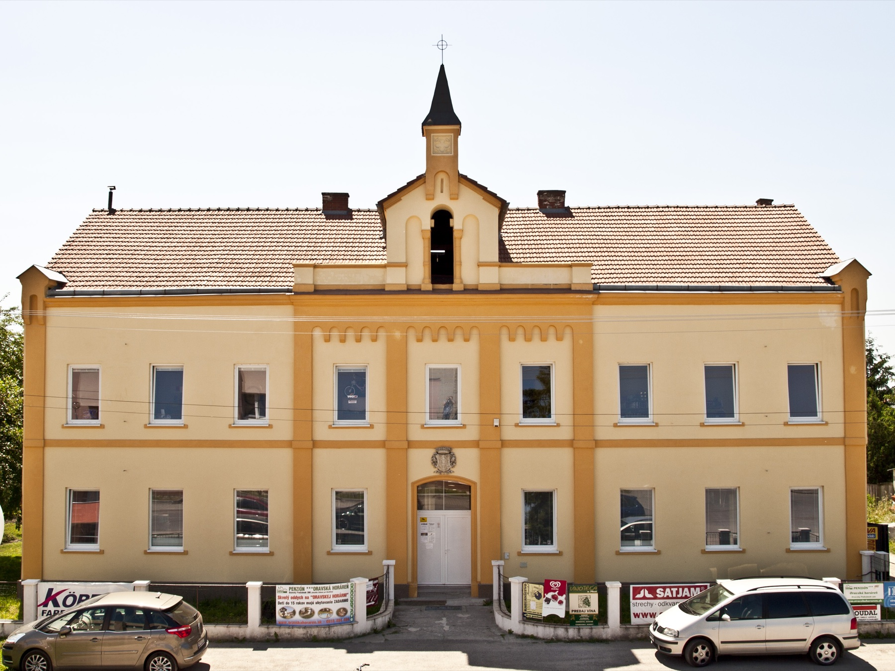
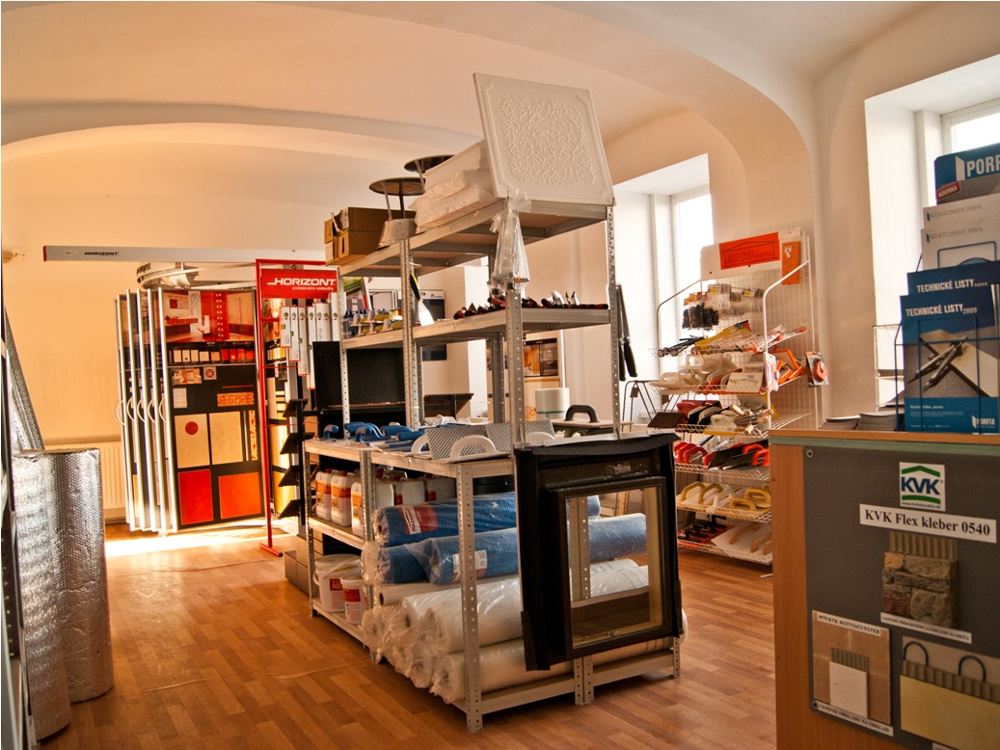
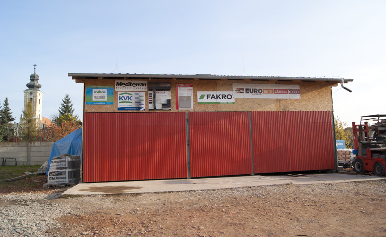
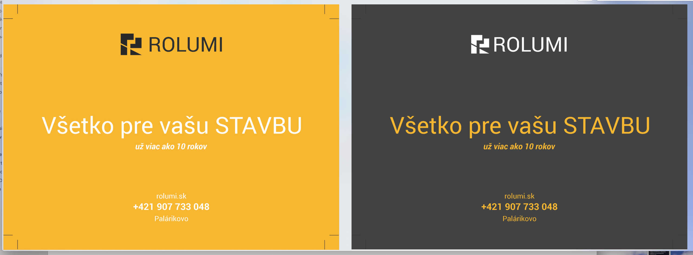
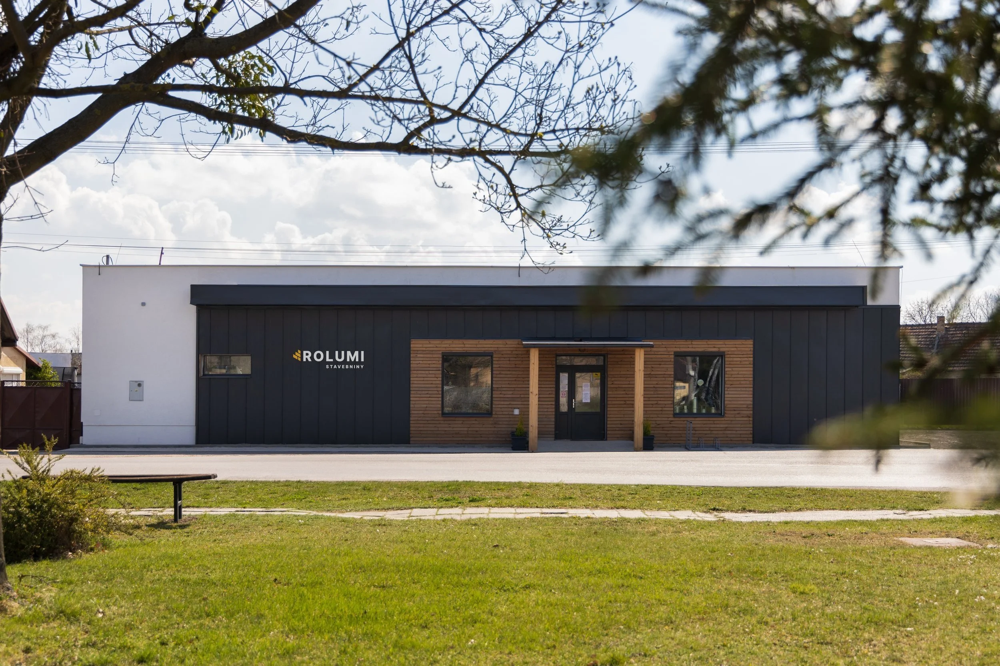

# História ROLUMI

**Od jednej palety k partnerovi pre celú stavbu**

**Vizuálna verzia:** [Otvoriť HTML príbeh](./HISTORIA_ROLUMI.html)

ROLUMI je rodinná firma z Palárikova, ktorá vyrástla z malého predaja stavebného materiálu a vybudovala si skúsenosť prepájajúcu materiál, odborné poradenstvo a realizáciu. Jej história nie je príbehom jedného veľkého skoku. Je príbehom postupného rastu, remeselnej skúsenosti, odvahy obnoviť zanedbané miesto a ochoty prevziať zodpovednosť za výsledok.

> Najsilnejšia komunikačná línia ROLUMI je jednoduchá: začínali sme s tým, čo sa zmestilo na jednu paletu. Vyrástli sme vďaka práci, skúsenostiam a dôvere zákazníkov.

Táto veta je pracovnou komunikačnou tézou. Nie je historickým sloganom ani novým schváleným claimom značky.

## Príbeh v skratke

Remeselné korene rodiny Rošteckých siahajú podľa interných spomienok k strechám a tesárskej práci približne na začiatok nového tisícročia. Podnikateľský príbeh stavebnín sa začal skromne. V prvej zimnej sezóne sa celý sklad podľa rodinného záznamu zmestil na jedinú paletu.

Firma Ľubica Roštecká, Stavebniny ROLUMI, oficiálne vznikla **7. júna 2006**. Prvá predajňa fungovala na Štúrovej 81 v Palárikove. Využívala časť prenajatého susedného pozemku a garáž pri rodinnom dome. Tento priestor slúžil do decembra 2008. Rastúci záujem zákazníkov však čoskoro ukázal, že firma potrebuje väčšie zázemie.

*Prvý skladový dvor pri rodinnom dome na Štúrovej 81. Fotografia bola súčasťou galérie „Krok po kroku“ na prvom zachovanom webe ROLUMI. Zdroj: archív ROLUMI.*

Ďalšou kapitolou sa stala bývalá cirkevná škola v centre Palárikova. Budova bola zanedbaná a vyžadovala celkovú obnovu. ROLUMI vymenilo okná, obnovilo fasádu a prestavalo takmer celý interiér. Z nevyužitého objektu postupne vznikol Dom obchodu a služieb. Predajňa získala dôstojné miesto a ďalšie priestory začali slúžiť miestnym nájomníkom. ROLUMI však objekt napokon neodkúpilo. Dnes ho naďalej využíva farský úrad.

*Bývalá cirkevná škola pred obnovou. Pôvodný web ju zachytáva ako zanedbaný objekt, ktorý potreboval celkovú rekonštrukciu. Zdroj: archív ROLUMI.*

*Obnova fasády a okien počas rekonštrukcie. Zdroj: archív ROLUMI.*

*Budova po rekonštrukcii. Z bývalej školy vznikol Dom obchodu a služieb a dočasné zázemie ROLUMI. Firma objekt napokon neodkúpila a dnes ho naďalej využíva farský úrad. Zdroj: archív ROLUMI.*

*Predajňa ROLUMI v obnovenej budove, približne 2010. Zdroj: archív ROLUMI.*

Zadný dvor sa prispôsobil skladovaniu paletového tovaru a v roku 2010 pribudol samostatný sklad. Sortiment sa postupne rozšíril od základného stavebného materiálu po strechy, odkvapy, izolácie, murivo, stavebnú chémiu, komínové systémy, sadrokartón, okná, dvere, dlažby, fasády a náradie. Už vtedajšia firemná komunikácia zdôrazňovala nielen predaj, ale aj ochotu pomôcť a poradiť.

*Nový sklad v zadnom dvore, pristavaný v roku 2010. Fotografia sa zachovala v galérii prvého webu ROLUMI. Zdroj: archív ROLUMI.*

Popri stavebninách sa rozvíjalo aj remeselné zázemie rodiny. Historické vizitky z roku 2012 zachytávajú dve prepojené línie. ROLUMI zastrešovalo stavebniny, železiarstvo a strešné centrum. ROLUMI PLUS komunikovalo tesárske a pokrývačské práce, poradenstvo a dodanie materiálu. Práve spojenie obchodu a realizácie sa neskôr stalo jednou z najdôležitejších výhod firmy.

V nasledujúcich rokoch ROLUMI ďalej rozširovalo ponuku aj digitálnu komunikáciu. Prvý zachovaný web bol spustený v decembri 2010. Novšie webové podklady už predstavujú firmu ako partnera, ktorý pomáha s výberom, pripraví cenovú kalkuláciu, zabezpečí dopravu a podľa typu zákazky aj realizáciu.

Roky 2018 až 2020 priniesli vedomú prácu so značkou. Firma hľadala spôsob, ako spojiť stavebniny a realizačnú časť pod jedným dôveryhodným menom. V roku 2019 sa už objavuje geometrická vizuálna identita ROLUMI a komunikácia postavená na myšlienke „Všetko pre vašu stavbu“. Neskôr bol tento smer spracovaný do súčasného brand systému.

*Jedna z etáp vývoja vizuálnej identity, 2019. Ide o historický podklad, nie o aktuálnu šablónu značky. Zdroj: archív ROLUMI.*

Približne v roku 2020 ROLUMI dokončilo novú budovu stavebnín na Remeselníckej 1. Moderná predajňa vytvorila dôstojný priestor pre zákazníkov aj zázemie pre ďalší rozvoj firmy. ROLUMI vlastní budovu spolu s priľahlým areálom, ktorý sa využíva ako skladové zázemie. Celok je ďalším viditeľným dôkazom postupného rastu od skladu pri rodinnom dome k stabilnej lokálnej firme.

*Najnovšia budova stavebnín ROLUMI na Remeselníckej 1, dokončená približne v roku 2020. Zdroj: aktuálny web ROLUMI.*

V roku 2024 si menšiu časť areálu prenajala spoločnosť ROSIV, zameraná na prácu s masívnym drevom. Spoločnosť vlastnia deti rodiny Rošteckých, ktoré tak pokračujú v rodinnej remeselnej tradícii a v práci s drevom.

Priestory slúžili maloobchodu do roku 2026. Tým sa uzatvára jedna dôležitá etapa, nie celý príbeh. ROLUMI má za sebou dve desaťročia skúseností s materiálom, reálnou stavbou aj zodpovednosťou za dokončené dielo. Na tomto základe firmu čaká transformácia a nová etapa.

## Časová os

| Obdobie | Míľnik | Význam |
|---|---|---|
| Okolo roku 2000 | Prvé skúsenosti so strechami, tesárskou a pokrývačskou prácou | Remeselný základ budúcej firmy. Rok je približný podľa interného brandového dotazníka. |
| Okolo roku 2005 | Skromné podnikateľské začiatky | Podľa rodinnej spomienky sa zásoba počas prvej zimy zmestila na jednu paletu. Rok je približný. |
| **7. jún 2006** | Oficiálny vznik firmy Ľubica Roštecká, Stavebniny ROLUMI | Presný začiatok podnikateľskej histórie stavebnín. |
| 2007 | Prvá zachovaná inzercia v archíve | Doklad aktívneho predaja strešných materiálov a budovania lokálneho povedomia. |
| Do decembra 2008 | Predajňa na Štúrovej 81 | Prvé zázemie tvoril prenajatý pozemok a garáž pri rodinnom dome. |
| 2008 až 2010 | Obnova bývalej cirkevnej školy | Zanedbaná budova sa zmenila na predajňu a Dom obchodu a služieb. ROLUMI ju napokon neodkúpilo a dnes ju využíva farský úrad. |
| 2010 | Vybudovanie skladu a spustenie prvého zachovaného webu | Väčšia kapacita, širší sortiment a začiatok systematickej digitálnej komunikácie. |
| 2011 | Rozširovanie ponuky | Archív zachytáva nové produktové kategórie aj krátke obdobie cyklistického sortimentu. |
| 2012 | Jasnejšie prepojenie obchodu a remesla | ROLUMI komunikuje stavebniny a strešné centrum. ROLUMI PLUS tesárstvo, pokrývačstvo, poradenstvo a materiál. |
| 2018 až 2020 | Hľadanie spoločnej identity | Firma rieši modernizáciu značky a zjednotenie obchodnej a realizačnej časti. |
| 2019 | Nový vizuálny smer | V archíve sa objavuje geometrické logo a komunikácia „Všetko pre vašu stavbu“. |
| Okolo roku 2020 | Dokončenie novej budovy stavebnín | Moderná predajňa na Remeselníckej 1 a priľahlý areál využívaný na sklady sa stávajú novým vlastným zázemím firmy. Rok je približný podľa potvrdenia zadávateľa. |
| 2023 | Komplexnejšia prezentácia služieb | Zachovaný web spája predajňu, stavebné práce, referencie, poradenstvo, kalkuláciu a dopravu. |
| 2024 | ROSIV vstupuje do areálu | Menšiu časť areálu si prenajíma spoločnosť detí rodiny Rošteckých, zameraná na prácu s masívnym drevom. |
| 2026 | Koniec maloobchodnej etapy a začiatok transformácie | Priestory prestali slúžiť maloobchodu. Dvadsať rokov skúseností sa stáva základom novej etapy ROLUMI. |
| 2026 až 2030 | Transformácia ROLUMI 2030 | ROLUMI premieňa dve desaťročia skúseností na nový model fungovania. Transformácia prepája budúce využitie areálu, riadenie stavebných projektov, značku, nový web, marketing a obchod. |

## Čo je na príbehu ROLUMI jedinečné

### 1. Firma vyrástla zdola

Príbeh jednej palety je silný preto, že je konkrétny a pravdivý. ROLUMI nevzniklo ako hotový projekt s veľkým zázemím. Kapacitu, sortiment aj dôveru si budovalo postupne.

### 2. ROLUMI obnovilo miesto, nielen predajňu

Presun do bývalej cirkevnej školy nebol obyčajnou zmenou adresy. Firma prevzala zanedbanú budovu, zrekonštruovala ju a vrátila jej funkciu. Je to dôkaz iniciatívy, vzťahu k Palárikovu a schopnosti meniť plány na skutočný výsledok.

### 3. Materiál a remeslo sa vyvíjali spolu

Skúsenosť ROLUMI nevznikla iba za pultom. Firma pozná materiály aj ich použitie na stavbe. Zákazník preto nezískava iba položku zo skladu, ale praktické odporúčanie podložené realizáciou.

### 4. Je to rodinný príbeh

Názov ROLUMI je v internom brandovom dotazníku vysvetlený ako spojenie **RO** z mena Rošteckí, **LU** z mena Ľubica a **MI** z mena Miloš. Rodinný pôvod nie je dekorácia. Je súčasťou kontinuity, osobnej zodpovednosti a spôsobu, akým firma budovala vzťahy so zákazníkmi. Od roku 2024 túto kontinuitu rozvíja aj ROSIV, spoločnosť detí rodiny Rošteckých zameraná na masívne drevo.

### 5. Rast nikdy nebol iba o veľkosti

Najdôležitejšou zmenou nebolo množstvo skladových zásob. Bola ňou schopnosť prevziať väčšiu časť zákazníkovej starosti. Od materiálu a rady cez dopravu až po remeselnú realizáciu. Ukončenie maloobchodnej etapy v roku 2026 preto nie je koncom príbehu, ale východiskom ďalšej transformácie.

## Komunikačný základ značky

### Podstata príbehu

**Rodinná firma, ktorá vyrástla z jednej palety na partnera pre celú stavbu.**

### Prísľub

Rozumieme materiálu aj realizácii. Pomáhame zákazníkovi urobiť správne rozhodnutie a dotiahnuť stavbu do výsledku.

### Dôkazy

- oficiálna kontinuita od 7. júna 2006,
- postupný rast z malého rodinného zázemia,
- obnova bývalej cirkevnej školy a vybudovanie skladu,
- dokončenie vlastnej modernej budovy stavebnín približne v roku 2020,
- dlhoročná skúsenosť s predajom stavebných materiálov,
- vlastná remeselná a realizačná skúsenosť,
- dlhodobé pôsobenie v Palárikove a vzťahy s miestnymi zákazníkmi.

### Tón komunikácie

- vecný a sebavedomý, nie veľkohubý,
- ľudský a priamy, nie korporátny,
- hrdý na pôvod, ale orientovaný na budúcnosť,
- konkrétny, s dôkazmi namiesto všeobecných superlatívov,
- odborný, ale zrozumiteľný pre človeka, ktorý nestavia každý deň.

### Motívy, ktoré sa oplatí opakovať

- jedna paleta ako symbol skromného začiatku,
- obnovená škola ako symbol iniciatívy a vzťahu k miestu,
- sklad ako symbol rastu a pripravenosti,
- nová budova ako symbol stability a ďalšej etapy rastu,
- materiál spolu s realizáciou ako dôkaz praktickej odbornosti,
- ROSIV ako pokračovanie rodinnej práce s drevom v ďalšej generácii,
- rok 2026 ako uzavretie maloobchodnej etapy a začiatok transformácie.

### Čomu sa vyhnúť

- tvrdeniu, že ROLUMI vzniklo v roku 2000 alebo 2005. Oficiálny dátum vzniku je 7. jún 2006,
- prezentovaniu každej historickej vizuálnej etapy ako dnešnej identity,
- neurčitým frázam ako „sme najlepší“ bez konkrétneho dôkazu,
- nostalgii bez väzby na dnešnú hodnotu pre zákazníka,
- tvrdeniu, že ROLUMI vlastní budovu bývalej cirkevnej školy. Firma ju zrekonštruovala, ale napokon neodkúpila,
- zamieňaniu histórie stavebnín s presným právnym vývojom jednotlivých spoločností.

## Texty pripravené na použitie

### Webová sekcia O nás

ROLUMI je rodinná firma z Palárikova. Oficiálne sme začali 7. júna 2006 v malej predajni pri rodinnom dome. Počas prvej zimnej sezóny sa naše zásoby podľa rodinnej spomienky zmestili na jedinú paletu. Záujem zákazníkov však rástol a spolu s ním aj naše skúsenosti, sortiment a zodpovednosť.

Ďalším veľkým krokom bola obnova bývalej cirkevnej školy v centre Palárikova. Zo zanedbanej budovy vznikla predajňa a Dom obchodu a služieb. Objekt sme napokon neodkúpili a dnes ho opäť využíva farský úrad. Popri predaji stavebných materiálov sa ďalej rozvíjali tesárske, pokrývačské a stavebné práce.

Približne v roku 2020 sme dokončili novú budovu stavebnín na Remeselníckej 1. Spolu s ňou vlastníme priľahlý areál využívaný ako skladové zázemie. V roku 2024 si menšiu časť areálu prenajala spoločnosť ROSIV, ktorú vlastnia deti rodiny Rošteckých a pokračujú v nej v práci s masívnym drevom.

Priestory slúžili maloobchodu do roku 2026. Po dvoch desaťročiach sa tým uzatvára jedna dôležitá etapa ROLUMI a začína sa transformácia firmy. Do ďalšej etapy si nesieme skúsenosti s materiálom, remeslom aj realizáciou a rodinnú zodpovednosť, na ktorej ROLUMI vyrástlo.

### Krátky profil

ROLUMI je rodinná firma z Palárikova s históriou od roku 2006. Z jednej palety zásob vyrástla až k vlastnej budove a skladovému areálu. Po uzavretí maloobchodnej etapy v roku 2026 vstupuje do ďalšej transformácie so skúsenosťami s materiálom, remeslom a realizáciou.

### Text na sociálne siete

Začínali sme skromne. Počas prvej zimy sa naše zásoby zmestili na jednu paletu. Od 7. júna 2006 sme spolu so zákazníkmi, každou dodávkou a každou dokončenou stavbou rástli. Po dvadsiatich rokoch sa uzatvára maloobchodná etapa a otvára sa nová kapitola ROLUMI. Do nej si nesieme skúsenosti s materiálom, drevom aj remeslom.

### Profil do prezentácie alebo PR materiálu

ROLUMI vzniklo v Palárikove 7. júna 2006 ako malá rodinná predajňa stavebného materiálu. Rastúci záujem viedol k dočasnému presunu do zrekonštruovanej budovy bývalej cirkevnej školy, k vybudovaniu skladového zázemia a približne v roku 2020 aj k dokončeniu vlastnej budovy stavebnín s priľahlým areálom na Remeselníckej 1. V roku 2024 do areálu vstúpila spoločnosť ROSIV, v ktorej ďalšia generácia rodiny pokračuje v práci s masívnym drevom. Maloobchodná etapa ROLUMI sa uzatvorila v roku 2026 a vytvorila základ pre ďalšiu transformáciu firmy.

## Poznámky k presnosti

- **7. jún 2006** je presný dátum uvedený na pôvodnom firemnom webe.
- Roky **okolo 2000** a **okolo 2005** sú približné rodinné spomienky z interného brandového dotazníka. V externej komunikácii ich treba uvádzať iba ako približné obdobia.
- Fotografia prvého skladového dvora je priradená k Štúrovej 81 podľa poradia záberov a sprievodného textu v pôvodnej galérii „Krok po kroku“.
- Budovu bývalej cirkevnej školy ROLUMI zrekonštruovalo a dočasne využívalo, ale napokon ju neodkúpilo. Dnes ju naďalej využíva farský úrad.
- Vlastníctvo ROLUMI sa vzťahuje na novšiu budovu na Remeselníckej 1 a priľahlý areál využívaný ako skladové zázemie, nie na bývalú cirkevnú školu.
- Dokončenie novej budovy stavebnín je zaradené približne do roku 2020 podľa potvrdenia zadávateľa. Fotografia pochádza z aktuálneho webu ROLUMI a nemusí zachytávať stavbu priamo v roku dokončenia.
- Vstup spoločnosti ROSIV do časti areálu v roku 2024 a ukončenie maloobchodného využitia priestorov v roku 2026 potvrdil zadávateľ pri spracovaní histórie.
- Rok pri fotografii vyjadruje jej zaradenie v archíve alebo obdobie použitia. Nemusí byť dátumom nasnímania originálu.
- Vizuál z roku 2019 dokumentuje vývoj značky. Aktuálne výstupy sa riadia súčasným brand systémom ROLUMI.

## Hlavné archívne zdroje

- [Pôvodná stránka O firme, `ofirme.php`](https://drive.google.com/file/d/1rS1QrNboNOL7WBHyylEv0UOILMEi12wB/view)
- [Fotogaléria „Krok po kroku“ z prvého webu](https://drive.google.com/drive/folders/1DsZu9sz0dyb01G1CJgxmqqcEHnznEuET)
- [Interný brandový dotazník](https://drive.google.com/file/d/1WksQyVcZZ3oshRXxPSHHHi04A8Wp2GNQ/view)
- [Historický návrh identity s motívom letokruhov](https://drive.google.com/file/d/1pdLtVgit783jYDW6OU7bc4viOvLJj9Pm/view)
- [Vizuálna komunikácia ROLUMI z roku 2019](https://drive.google.com/file/d/1riao8RYKrXvkDX94wlJFXfG7FFWwd9kT/view)
- [Zachovaný web ROLUMI z roku 2023](https://drive.google.com/file/d/1dY3KPdvkdPAOaOO4XsnEHztRyiHF_-Tm/view)
- [Aktuálny web ROLUMI](https://www.rolumi.sk/)

Kompletné podklady, pôvodné fotografie, webové zálohy a pracovné návrhy zostávajú v `My Drive / ROLUMI / ARCHIV`. V tejto sekcii sú uložené iba vybrané obrazové podklady potrebné na čítanie príbehu v Backstage.
